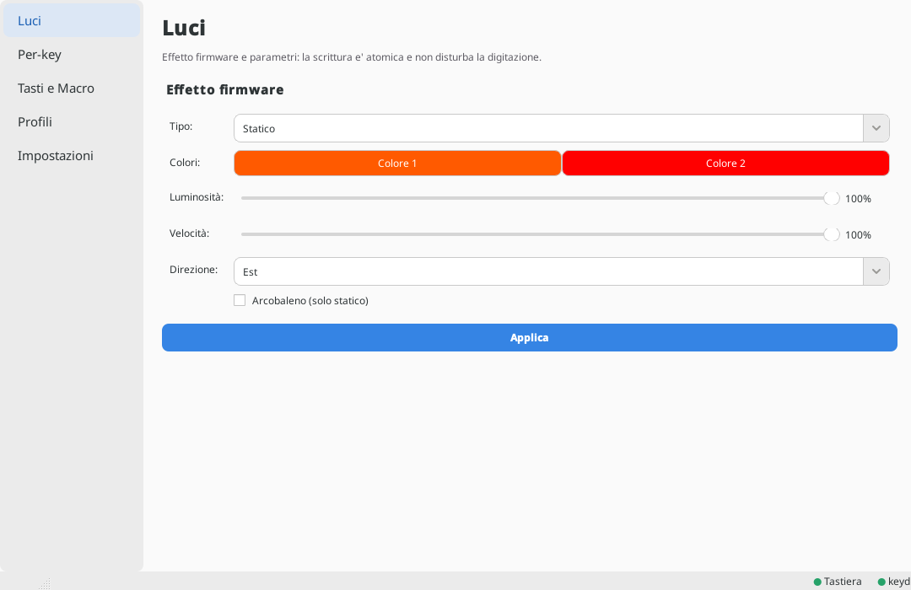
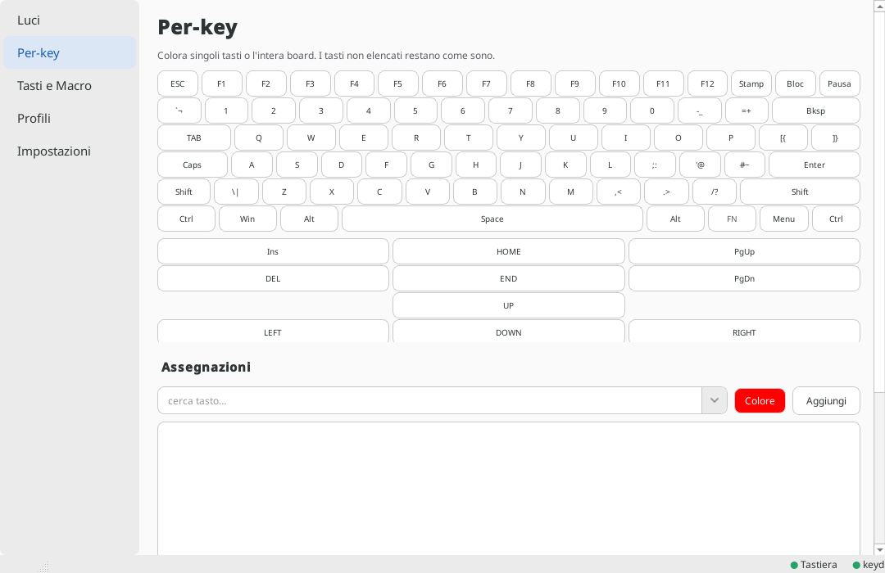
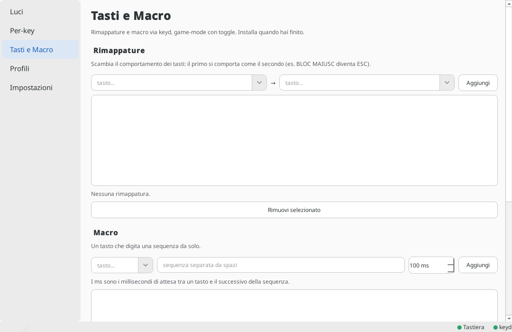
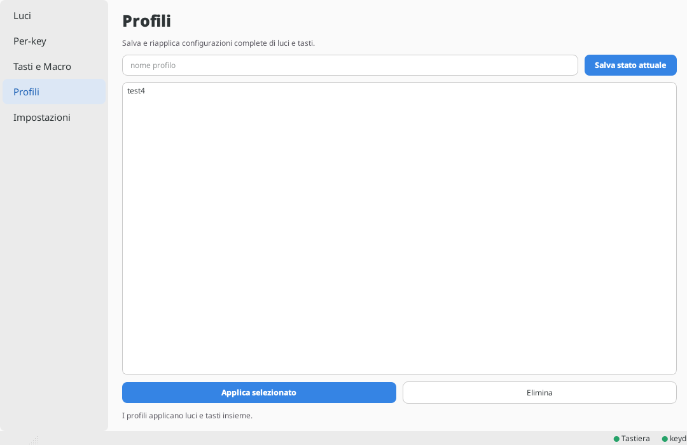
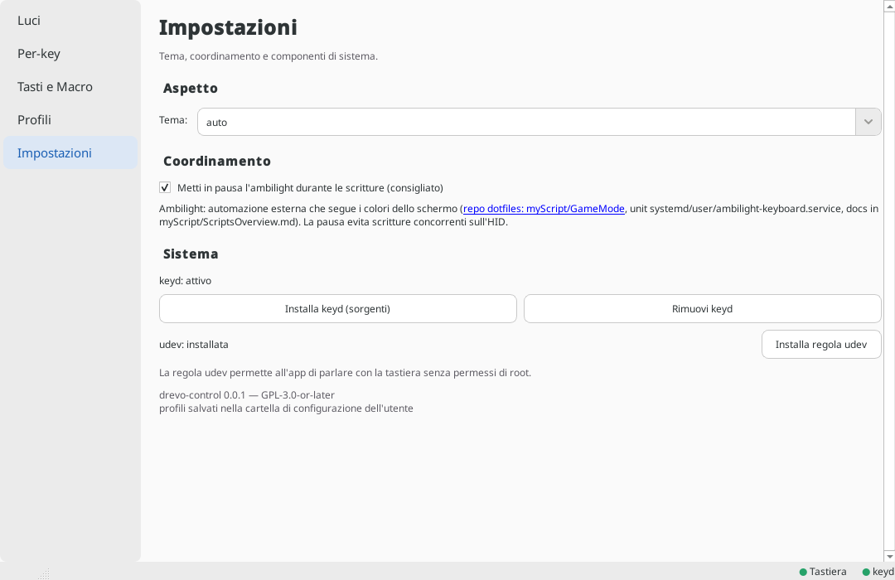

# drevo-linux


Controllo Linux con GUI per tastiere Drevo su controller Winbond
(`0416:a0f8` — Tyrfing V2 / Calibur V2 TE), a parita' funzionale di
Drevo Power Console per le funzioni device-local.

Stato: funzionante e verificato su hardware (0416:a0f8).

> [!WARNING]
> Progetto sperimentale: il core (protocollo, CLI, profili) e' stabile e
> testato, ma l'interfaccia grafica e' ancora grezza e in evoluzione —
> aspettatevi spigoli vivi su look e layout.

## Indice

- [Funzionalità](#funzionalità) · [Installazione](#installazione-un-comando)
- [Dipendenze](#dipendenze) · [Layout](#layout) · [Licenza](#licenza)
- Documentazione tecnica: [docs/](docs/) (architettura, protocollo,
  GUI, packaging, test, reverse engineering, terze parti)

## Scope

IN: layout, programmazione tasti/macro, RGB, game mode, profili locali +
salvataggio onboard. FUORI: cloud sync, firmware flashing (solo lettura
versione).

## Vincoli

Solo userspace + udev, un solo writer HID alla volta, scritture solo su
evento (il controller Winbond va in reset-loop con scritture frequenti).
Reverse solo black-box sul device fisico; niente decompilazione.

## Funzionalità

### Luci
Effetti firmware (statico, respiro, scorrimento, radar, memoria) con
colori, luminosità, velocità, direzione e arcobaleno.



### Per-key
Tastiera ISO disegnata e cliccabile: colora singoli tasti o l'intera
board. I tasti non elencati restano come sono.



### Tasti e Macro
Rimappature, macro con timeout e game-mode con interruttore, via keyd.
Anteprima config e ripristino in un clic.



### Profili
Salva e riapplica configurazioni complete di luci e tasti.



### Impostazioni
Tema auto/chiaro/scuro, coordinamento, stato di keyd e udev.



## Installazione (un comando)

Copia e incolla in un terminale (funziona dopo il push su GitHub):

```sh
curl -sSL https://github.com/lorenzo0932/drevo-linux/raw/main/install.sh | bash
```

Con keyd incluso:

```sh
curl -sSL https://github.com/lorenzo0932/drevo-linux/raw/main/install.sh | bash -s -- --with-keyd
```

In locale dalla cartella del repo: `bash install.sh [--with-keyd]`.

Crea un venv isolato in `~/.local/share/drevo-linux`, installa via pip
(base + GUI), linka i comandi in `~/.local/bin`, voce di menu e regola
udev (l'unico passo che chiede sudo). Richiede solo Python ≥ 3.10:
l'utente non tocca mai pip. Con `--with-keyd` compila keyd dai sorgenti.

Disinstallazione: `bash uninstall.sh [--purge] [--remove-keyd]`
(`--purge` cancella anche profili e impostazioni).

Nota formato: niente AppImage/Flatpak di proposito — udev, keyd come
servizio e integrazione menu richiedono comunque passi sull'host, quindi
un AppImage non eliminerebbe il comando di installazione; il formato
scelto e' pacchetto pip + installer. Dettagli dipendenze sotto.

## Dipendenze

Requisiti: Python 3.10+ (testato su 3.14). L'accesso HID usa `hidapi` (le wheel `hid`/`PySide6`
su pip includono i binari; se `import hid` fallisce, installa la libreria
di sistema, es. `hidapi`).

```sh
pip install .[gui]
drevo-control effect static 255 90 0   # CLI
drevo-control-gui                        # GUI
```

La GUI richiede l'extra `gui` (PySide6). Regola udev e voce di menu:

```sh
sudo cp udev/77-drevo-control.rules /etc/udev/rules.d/
sudo udevadm control --reload-rules && sudo udevadm trigger
cp drevo-control.desktop ~/.local/share/applications/
```

keyd (remap/macro/game-mode) si installa da Impostazioni, dai sorgenti
senza package manager (serve gcc/make/git). Il firmware si aggiorna
solo da Windows.

## Riconoscimenti

Si appoggia a [keyd](https://github.com/rvaiya/keyd),
[hidapi](https://github.com/libusb/hidapi), [Qt for Python](https://wiki.qt.io/Qt_for_Python)
e al lavoro di reverse del protocollo di [dtv2](https://github.com/cobacdavid/dtv2)
(integrazioni, riferimenti e licenze in [docs/third-party.md](docs/third-party.md)).

## Licenza

GPL-3.0-or-later — vedi [LICENSE](LICENSE).

## Layout

- `src/drevo_control/` — `protocol/` (HID), `oslayer/` (keyd/profili),
  `gui/` (Qt), `data/` (udev, script keyd, icone)
- `tools/` — survey, catture, rollback, test guidati
- `docs/` — baseline, protocollo, setup
- `plan/` — piano di feature, mai committato (gitignored)
