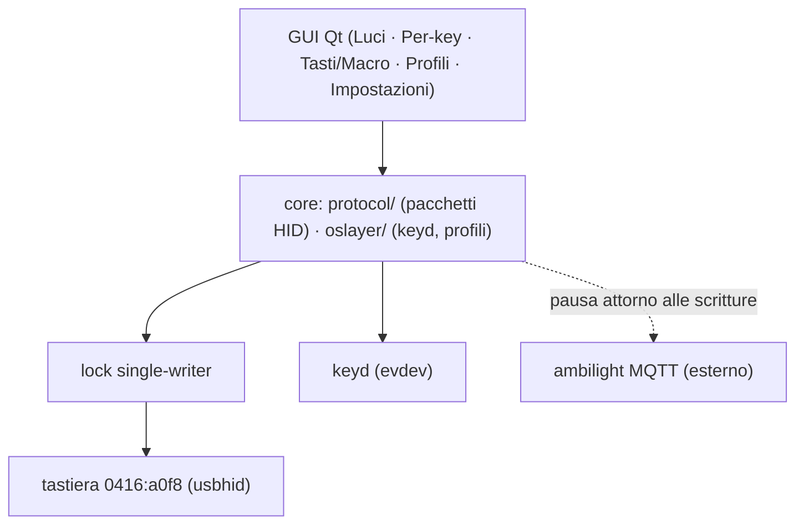

# Architettura



```
┌──────────── GUI Qt (PySide6) ────────────┐
│ Luci │ Per-key │ Tasti/Macro │ Profili   │ Impostazioni
├──────────── core ────────────────────────┤
│ protocol/  lighting + per-key (HID OUT)  │
│ oslayer/   keyd (evdev) + profili JSON   │
└──────────── sistema ─────────────────────┘
  tastiera 0416:a0f8 (usbhid)   keyd (evdev)   ambilight (MQTT, esterno)
```

## Layer e responsabilità

- `protocol/` (`commands.py`, `board.py`, `keymap.py`, `device.py`):
  costruisce pacchetti e scrive sull'iface 1. Nessuna logica di policy.
- `oslayer/` (`keyd.py`, `profiles.py`, `apply.py`, `daemon.py`):
  remap/macro/game-mode come testo keyd, profili JSON, apply coordinato.
- `gui/`: solo presentazione; riusa core e oslayer, mai duplicati.
- `lock.py`: lock file single-writer `/tmp/drevo_hid_writer.lock`.

## Invarianti (non negoziabili)

1. Un solo writer HID alla volta (il controller Winbond va in reset-loop
   con scritture frequenti/concorrenti).
2. Scritture solo su azione utente o evento, mai polling.
3. Il daemon ambilight e' esterno: lo si mette in pausa attorno alle
   scritture, mai modificato da qui.
4. Niente kernel/DKMS, niente decompilazione di software Drevo: solo
   userspace + osservazione del proprio traffico (vedi
   [reverse-engineering](reverse-engineering.md)).
